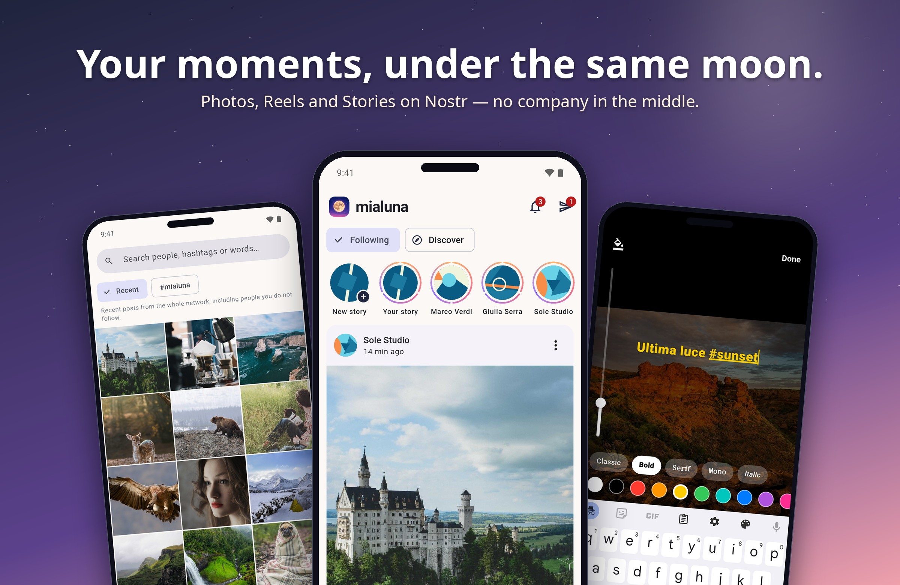
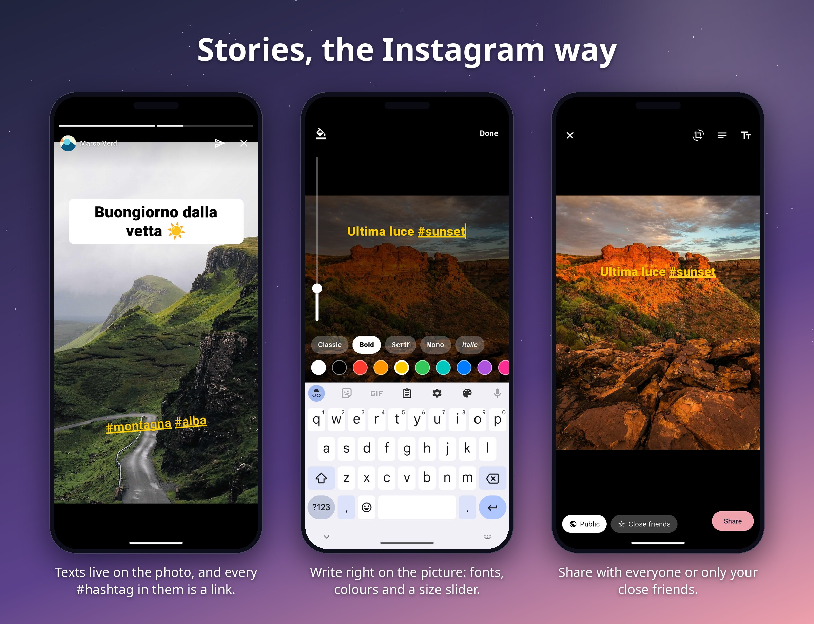
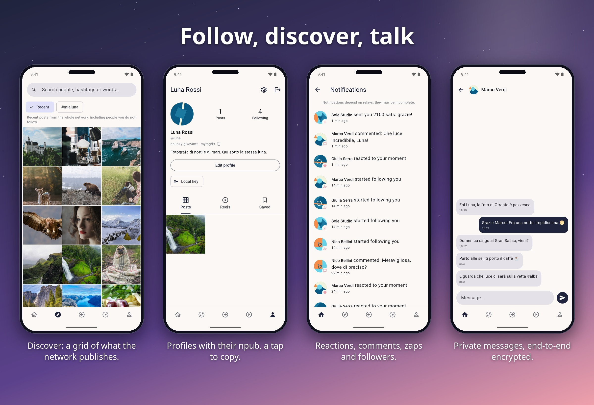
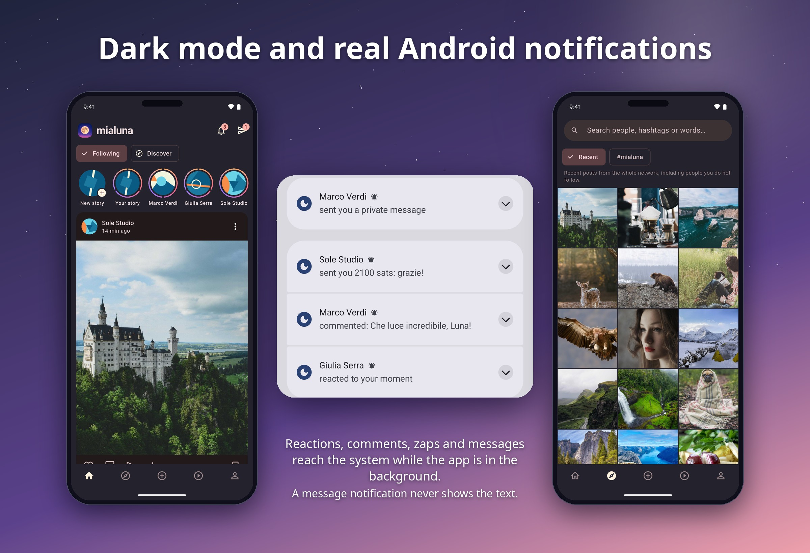

# Mialuna

<p align="center">
  
</p>

**Your moments, under the same moon.**

Mialuna is an open-source, decentralized visual social network built on
[Nostr](https://github.com/nostr-protocol/nips). Photos, carousels, videos,
Reels and Stories — with the familiar feel of Instagram, without any
centralized platform.

> Mialuna is **media-first**: text-only posts do not exist. Every post
> contains at least one photo or video.

<p align="center">
  
</p>

## Features

- **Photography** — NIP-68 (kind 20) feed, multi-image carousels, captions
  with clickable hashtags, alt text, built-in photo editor (crop, rotate,
  adjustments)
- **Videos & Reels** — NIP-71 publishing (kind 21/22), full-screen vertical
  Reels viewer with autoplay and preloading
- **Stories** — 24-hour visual moments via NIP-40 expiration. The story
  button (your picture with a plus) is always at the head of the rail; once you
  have published, a second circle shows your stories, and every ring is divided
  into one part per story of the last 24 hours. Texts are written right on the
  photo, like Instagram (fonts, colours, pill backgrounds, drag / pinch /
  rotate) and their `#hashtags` are tappable; public or close friends only;
  see who watched your story, from the note
- **Home & Discover** — Home shows the people you follow; Discover shows
  only your web of trust (media grid, hashtag and words search inside that
  network, official `#mialuna` feed) and finds people you trust by name
  (NIP-50 relays, NIP-05)
- **Social** — NIP-25 reactions, NIP-22 comments with nested replies,
  NIP-02 follow lists, bookmarks, NIP-57 Lightning zaps, notifications,
  profiles of anyone, pinch-to-zoom and inline video in the feed
- **Private messages** — NIP-17 (gift-wrapped, NIP-44), with one-tap
  forwarding of photos, videos, reels and stories from Home
- **Notifications** — red counts on the bell and the paper plane, and real
  Android notifications for reactions, comments, zaps, followers and messages
  while the app is in the background (made on the phone: no push server;
  message notifications never show the text)
- **Authentication** — Amber (NIP-55, Android), remote signers (NIP-46
  bunker), nsec advanced fallback, read-only guest mode
- **Media uploads** — Blossom (kind 24242 authorization, SHA-256 content
  addressing, ordered server fallback), automatic removal of every metadata
  trace before upload (fail-closed)
- **Deleting your posts** — a NIP-09 deletion request to every relay and a
  Blossom `DELETE` of the photos and videos from the media servers, for posts,
  reels and stories, close-friends ones included; your stories are deleted the
  same way once their 24 hours are over
- **Relays** — multi-relay pool with reconnect/backoff, NIP-65 relay lists
  synced automatically (read/write roles, outbox model), NIP-42 AUTH,
  per-relay publication reports, offline cache
- **Privacy & moderation** — mute, block, sensitive-content warnings (NIP-36),
  reporting, secure credential storage, a web of trust against spam that also
  fills Discover
- **Hardened by default** — no backups, no cleartext, private screens blocked
  from screenshots, safe fetching of third-party servers, signing out wipes the
  account (see [SECURITY.md](SECURITY.md) and [PRIVACY.md](PRIVACY.md))
- **Branding** — every post published from Mialuna carries `#mialuna`,
  without rejecting external posts that lack it

## Screenshots

<p align="center">
  
</p>
<p align="center">
  
</p>
<p align="center">
  
</p>

The pictures are taken from the debug build on an emulator against a local
relay with invented accounts and stock photos (picsum.photos); nothing in them
is a real person's.

## Project status

All four roadmap phases are implemented: photographic MVP, videos and Reels,
Stories and discovery, social polish. See [CHANGELOG.md](CHANGELOG.md),
[docs/ARCHITECTURE.md](docs/ARCHITECTURE.md) and
[docs/nostr-compatibility.md](docs/nostr-compatibility.md) for details and
known limitations.

## Build

Requirements: Flutter 3.47+, Android SDK 36, JDK 21.

```bash
flutter pub get
flutter test
flutter analyze
flutter build apk --debug
```

The toolchain is pinned with [mise](https://mise.jdx.dev/) (`mise.toml`):
`mise install` installs Flutter and Java. The Android SDK must be configured
separately (`flutter config --android-sdk <path>`).

For signed release builds and store preparation see
[docs/release.md](docs/release.md).

## Repository layout

```text
lib/
  app/       app shell, providers, routing
  core/      auth, nostr, media, storage, theme, branding
  features/  feed, explore, create, reels, stories, profile,
             comments, notifications, settings, onboarding, social
docs/        architecture, Nostr compatibility, release guide
```

## Contributing

Contributions are welcome — see [CONTRIBUTING.md](CONTRIBUTING.md). Security
reports: [SECURITY.md](SECURITY.md). Privacy notes are in
[PRIVACY.md](PRIVACY.md); third-party attributions in
[THIRD_PARTY_NOTICES.md](THIRD_PARTY_NOTICES.md).

## License

MIT — see [LICENSE](LICENSE).
